# JRDAact3_t4: CRUD con Spring Boot, JPA y MySQL (Producto → Categoría)

Actividad 3 del Tema 4 de Programación Web. CRUD completo conectado a una base de datos MySQL real, con una relación entre dos entidades (`Producto` muchos-a-uno `Categoria`) implementada con JPA, probado con Postman y desplegado en un VPS.

**Autor:** Daniel Juárez

**En línea:** http://165.22.188.79:8085/api/productos

## Tecnologías
- Java 21
- Spring Boot 4.1.2 (Spring Web MVC, Spring Data JPA / Hibernate)
- MySQL 8
- Thymeleaf (práctica del video con la entidad `City`)
- Maven (wrapper incluido)
- Postman

## Arquitectura

```
controller/
├── ProductoRestController.java    @RestController → CRUD de productos (JSON)
├── CategoriaRestController.java   @RestController → listar y crear categorías
└── CityController.java            @Controller     → vistas Thymeleaf del video
models/
├── Producto.java                  @Entity, @ManyToOne hacia Categoria
├── Categoria.java                 @Entity, @OneToMany(mappedBy = "categoria")
├── City.java                      @Entity (práctica del video)
└── dto/ProductoDTO.java           DTO con categoriaId y categoriaNombre
repository/
├── ProductoRepository.java        extends JpaRepository<Producto, Long>
├── CategoriaRepository.java       extends JpaRepository<Categoria, Long>
└── CityRepository.java
service/
├── ProductoService.java           lógica de negocio y validaciones
└── CategoriaService.java
```

| Capa | Responsabilidad |
|---|---|
| **Controller** | Recibe la petición HTTP y delega al Service. No contiene lógica de negocio |
| **Service** | Valida los datos, busca la categoría, convierte entidad ↔ DTO y maneja errores (400, 404) |
| **Repository** | Acceso a la base de datos con Spring Data JPA, sin escribir SQL |
| **Entity** | Mapea las tablas `producto` y `categoria` |

## Entidades y relación

Un producto pertenece a **una** categoría y una categoría tiene **muchos** productos. La llave foránea `categoria_id` vive en la tabla `producto`.

**`Producto`** (lado dueño de la relación, `@ManyToOne`):

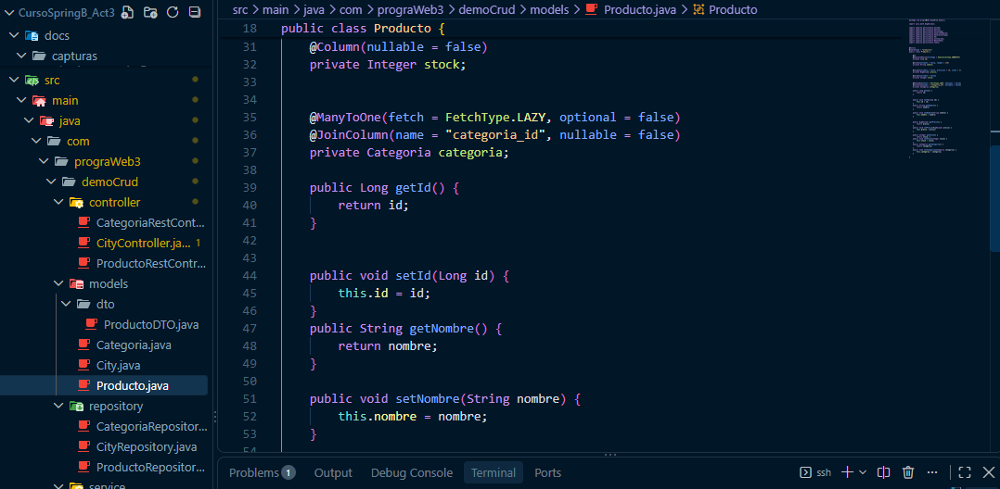

**`Categoria`** (lado inverso, `@OneToMany`):

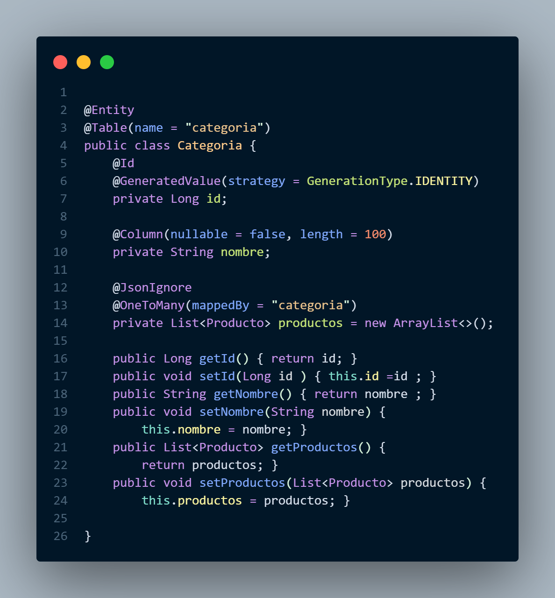

**Llave foránea creada en MySQL** (`producto.categoria_id → categoria.id`):

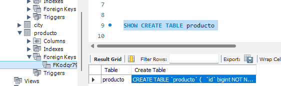

## Endpoints

| Operación | Método y ruta | Cuerpo |
|---|---|---|
| Crear categoría | `POST /api/categorias` | `{"nombre":"Electrónica"}` |
| Listar categorías | `GET /api/categorias` | |
| Crear producto | `POST /api/productos` | `{"nombre":"Mouse","precio":199.90,"stock":25,"categoriaId":1}` |
| Listar productos | `GET /api/productos` | |
| Ver un producto | `GET /api/productos/{id}` | |
| Actualizar | `PUT /api/productos/{id}` | igual que crear |
| Eliminar | `DELETE /api/productos/{id}` | |

La API responde con `ProductoDTO`, que incluye `categoriaNombre`, y no solo el id de la categoría. Si el `categoriaId` no existe responde `400`, y si el producto no existe responde `404`.

## CRUD funcionando (local, Postman)

### Crear (POST)
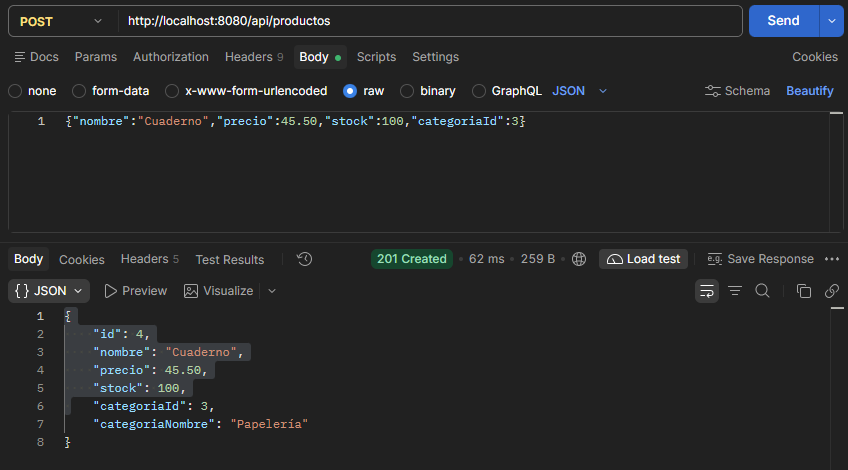

### Leer (GET), con el nombre de la categoría
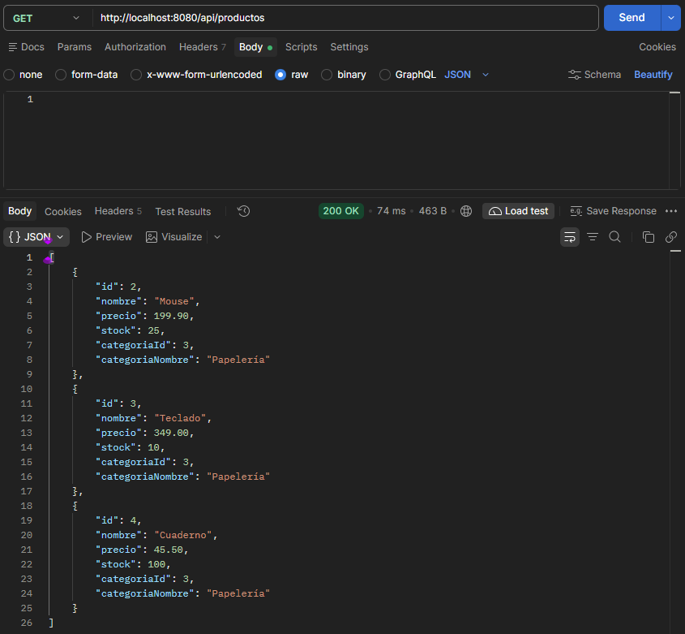

### Actualizar (PUT)
Se cambian nombre, precio, stock y también la categoría (de Papelería a Electrónica):

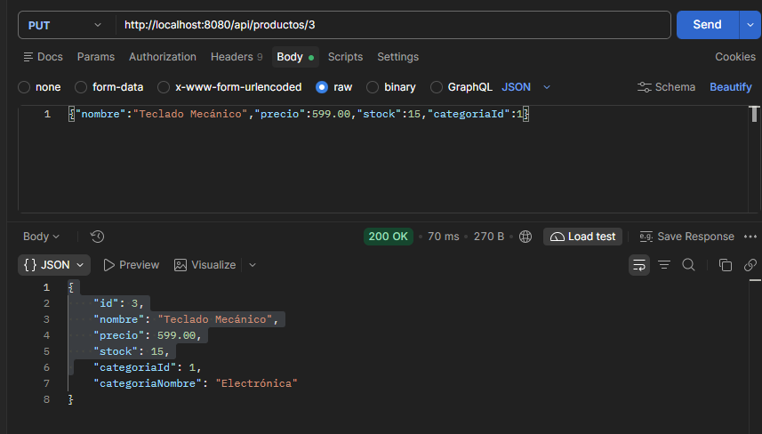

### Eliminar (DELETE)
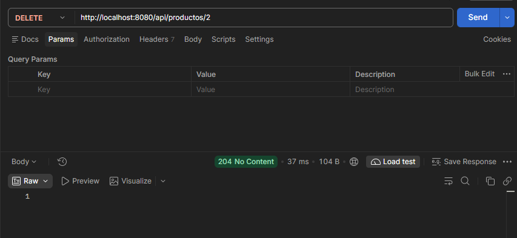

### Los datos persisten en MySQL, con la relación
Consulta `JOIN` entre `producto` y `categoria` en MySQL Workbench:

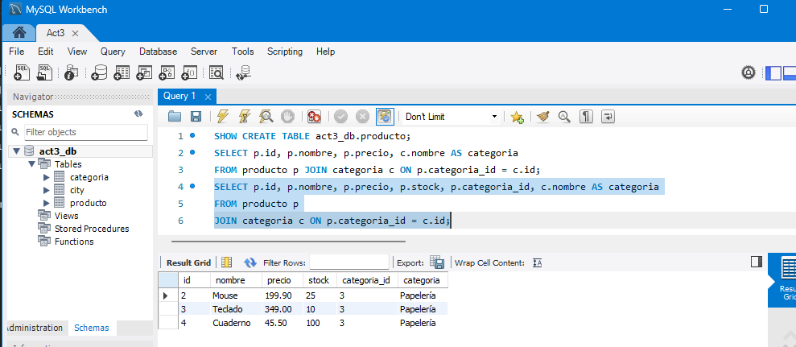

## Despliegue en el VPS

El proyecto corre en el puerto **8085**, con su propia base de datos `act3_db` en MySQL del VPS.

Crear una categoría en el VPS:

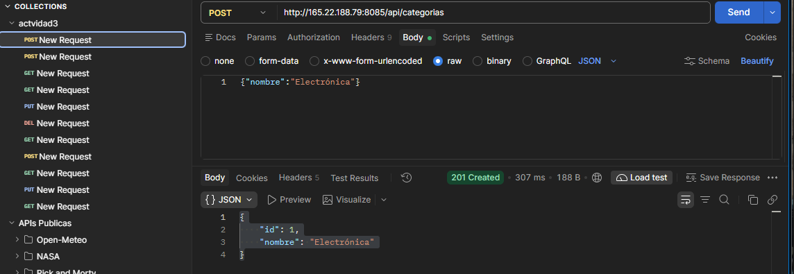

Leer productos en el VPS, con la relación:

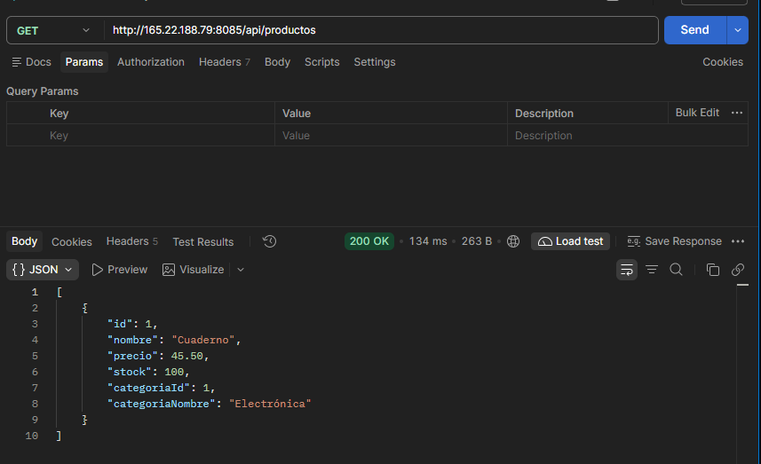

Abierto desde el navegador, fuera del servidor:

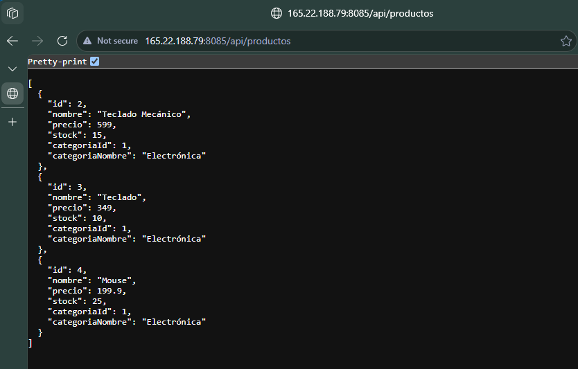

La relación en la base de datos del VPS:

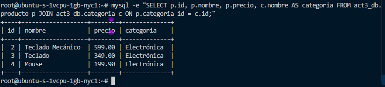

Las actividades anteriores siguen corriendo al mismo tiempo, sin cambios:

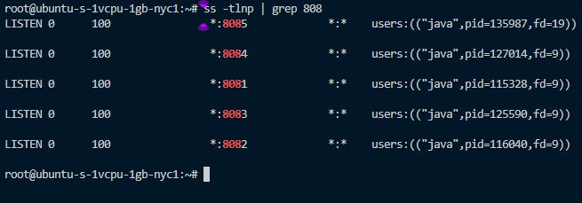

| Puerto | Proyecto |
|---|---|
| 8081 | Actividad 1 (JRDAact1_t4), sin cambios |
| 8082 | Compañero de VPS |
| 8083 | Actividad 2 (JRDAact2_t4), sin cambios |
| 8084 | Compañero de VPS |
| 8085 | **Actividad 3 (este proyecto)** |

## Práctica del video (City)
Se conserva la entidad `City` con vistas Thymeleaf, hecha siguiendo el video de referencia (CRUD con Spring Boot + JPA + MySQL). Está disponible en `/` y usa la misma base de datos.

## Ejecutar en local

**1. Crear la base de datos y el usuario en MySQL:**

```sql
CREATE DATABASE act3_db CHARACTER SET utf8mb4 COLLATE utf8mb4_unicode_ci;
CREATE USER 'act3_user'@'localhost' IDENTIFIED BY 'TU_CLAVE';
GRANT ALL PRIVILEGES ON act3_db.* TO 'act3_user'@'localhost';
```

**2. Crear `src/main/resources/local.properties`** (está en `.gitignore`, no se sube al repositorio):

```properties
spring.datasource.username=act3_user
spring.datasource.password=TU_CLAVE
```

`application.properties` apunta a `jdbc:mysql://localhost:3306/act3_db` e importa ese archivo. Hibernate crea las tablas solo (`ddl-auto=update`).

**3. Arrancar:**

```bash
.\mvnw.cmd spring-boot:run
```

Disponible en `http://localhost:8080`.

## Generar el JAR

```bash
.\mvnw.cmd clean package -DskipTests
```

El archivo queda en `target/demoCrud-0.0.1-SNAPSHOT.jar`.

## Despliegue en el VPS

Las credenciales de la base de datos no van en el repositorio. En el VPS se pasan por variables de entorno desde un archivo `.env` con permisos `600`, que tienen prioridad sobre `local.properties`.

```bash
scp target/demoCrud-0.0.1-SNAPSHOT.jar USUARIO@IP_DEL_VPS:~/jrda_act3/jrda_act3.jar

# en el VPS
cd ~/jrda_act3 && set -a && . ./.env && set +a
nohup java -Xmx192m -jar jrda_act3.jar --server.port=8085 > app.log 2>&1 &
```

`-Xmx192m` limita la memoria de la JVM, porque el VPS tiene 1 GB de RAM compartido con otras apps. MySQL se configuró con valores de bajo consumo y escucha solo en `127.0.0.1`. El puerto 8085 se abrió en `ufw`.

## Colección de Postman

[postman/actividad3.postman_collection.json](postman/actividad3.postman_collection.json)